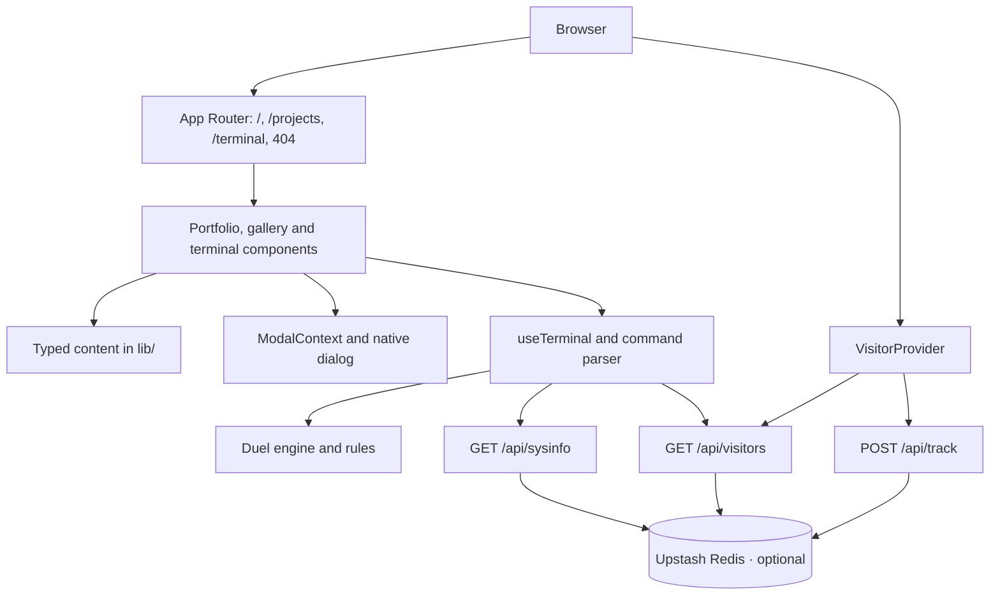

<h1 align="center">localhost-v1</h1>

<p align="center">
  Personal portfolio of <strong>Chanitnan Kitnantakhun</strong>, Backend / Systems Engineer.<br />
  A Phantom Thief–themed site built with <a href="https://nextjs.org">Next.js</a> and deployed on <a href="https://vercel.com">Vercel</a>.
</p>

<p align="center">
  <a href="https://chanitnan-kitnantakhun.vercel.app/"><strong>Live site</strong></a> ·
  <a href="https://chanitnan-kitnantakhun.vercel.app/projects">Projects</a> ·
  <a href="https://chanitnan-kitnantakhun.vercel.app/terminal">Terminal</a>
</p>

## Features

- **Persona 5-inspired hero.** An original masked character orbited by 52 unique playing cards. **Play** opens the terminal and types `play` to start the Joker card duel.
- **Competition timeline.** Six chapters with event photos. Select the photo to open that event's pop-up gallery.
- **Projects catalogue.** Open-source, collaborative, and personal work at `/projects`.
- **Interactive terminal.** `/terminal` and the 404 page share one command set, with history, Tab completion, and navigation.
- **Live visitor stats (optional).** Unique visitors by OS, stored in Upstash Redis.
- **Accessible by default.** Keyboard navigation, a native `<dialog>` gallery, and reduced-motion support. Animation pauses when the tab is hidden.

## Tech stack

- **Framework:** [Next.js 14](https://nextjs.org) App Router with [React 18](https://react.dev)
- **Language:** [TypeScript 5](https://www.typescriptlang.org)
- **Styling:** [Tailwind CSS 3](https://tailwindcss.com) plus global theme stylesheets
- **Animation:** [Framer Motion](https://www.framer.com/motion/)
- **Statistics (optional):** [Upstash Redis](https://upstash.com)
- **Fonts:** Inter and Roboto Condensed, bundled locally with their licenses
- **Package manager:** [Bun](https://bun.sh) (`npm run` works too)
- **Deployment:** [Vercel](https://vercel.com)

## Architecture

The site is a single Next.js App Router application. Server-rendered pages
compose the portfolio sections; interactive components use client-side React
state for the gallery, navigation, terminal, and card duel.



Project, timeline, card, and contact data live in `lib/`; their components
render the same data without a separate content service. `ModalContext`
manages the shared image gallery, while `useTerminal` connects the terminal
UI to its command parser and the local duel engine. Commands use predefined
destinations and project links rather than executing shell commands.

`VisitorProvider` sends a tracking request and then reads the count for the
Navbar and About section. The API routes use Redis on the server; visitor
identity is an approximation based on IP and operating system. If Redis is
unavailable, the interface falls back to demo or hidden statistics.

## Getting started

```sh
git clone https://github.com/chanitnan0jr/localhost-v1.git
cd localhost-v1
bun install --frozen-lockfile
bun run dev
```

Open [http://localhost:4000](http://localhost:4000).
For a production build, run `bun run build`, then `bun run start`.

### Visitor statistics (optional)

Create `.env.local` with these server-only values:

```env
UPSTASH_REDIS_REST_URL=https://your-database.upstash.io
UPSTASH_REDIS_REST_TOKEN=your-token
```

Without Redis the site still works: the Navbar shows a demo count, About hides its visitor badge, and the terminal prints demo statistics.
Visitor identity is approximately IP + OS, using trusted proxy headers. `/api/visitors` responds with caching disabled.

## Project structure

```
app/                  Routes: home, /projects, /terminal, 404, plus global styles and fonts
├── api/              /api/track, /api/visitors, /api/sysinfo
components/
├── phantom/          Hero, card orbit, playing cards, timeline, terminal
├── home/             About, lab research, certifications, contact
├── projects/         Project header, sections, cards
├── not-found/        Boot-sequence shell for the 404 page
├── layout/           Navbar, Footer
└── ui/               Shared image/gallery dialog, network background
context/              Image dialog and visitor statistics providers
hooks/                useTerminal, useToggle, useStackCarousel
lib/                  Typed content, terminal commands, Redis and visitor helpers
├── game/             Duel rules, engine, Joker replies and terminal session text
public/images/        Photos and certificates
scripts/check.cjs     Regression checks with Node assertions
```

Pages stay thin and compose components. Content lives in `lib/`, and client-only state lives in hooks and context.

## Terminal

`/terminal` and every unmatched route (including `/dev/null`) run the same commands from `lib/terminalCommands.ts` through the `useTerminal` hook. The 404 page adds a boot sequence and its own bash-style shell.

| Command | Result |
| --- | --- |
| `help` | Command table |
| `play` | Duel the Joker card (the hero's **Play** button opens `/terminal?run=play`, which types it for you): `attack`, `defend`, `evade` or `counter` each round; `hint` (3 per duel) and `talk` use no round; `stop` or `quit` ends it |
| `projects` | List projects with their ids |
| `connect <project>`, `github <project>` | Open a project's live demo or source code in a new tab |
| `whoami`, `cat about` | Short introduction |
| `ls`, `deck` | The six navigation cards |
| `cat projects`, `cat contact` | Project list and contact details |
| `open <home\|projects\|work\|about\|terminal\|contact>` | Navigate (`cd` and `goto` are aliases; `exit` goes home) |
| `skills`, `stack`, `fastfetch`, `neofetch` | Engineering stack |
| `visitors`, `viewcount`, `stats` | Live visitor statistics |
| `history`, `date`, `uptime`, `uname`, `echo`, `clear` | Shell basics |

Keys:
- **↑ / ↓** recall history.
- **Tab** cycles suggestions.
- **Enter** or **→** accepts a suggestion.
- **Escape** clears the input, and **Ctrl+L** clears the screen.

During a duel the prompt becomes `visitor@duel:~$`, each round prints a HUD with both HP bars and the Joker's SP, and only the four moves, `hint`, `talk`, `stop` and `quit` are accepted. The Joker picks its move when the round starts, so a hint ("You should prepare to dodge", "You should attack me next turn") always tells the truth. Attacking again and again is risky: each attack in a row gives the Joker another 15% to dodge (up to 60%, shown in the HUD as `attack (30% dodge)`), and after a dodge it counters at the same chance. Any other move resets the streak.
Game rules and balance numbers live in `lib/game/` (`rules.ts`, `engine.ts`); `bun run test` covers them and `bun scripts/simulate-duel.ts` reports win rates per strategy.

Commands never run a shell or fetch arbitrary URLs: `connect` and `github` only open links listed in `lib/projectsData.ts`.

## Color reference

| Color | Hex | Used for |
| --- | --- | --- |
| Night black | `#0b0c0f` | Page background |
| Ink black | `#0c0b0a` | Surfaces (Tailwind `background`) |
| Ivory | `#eee9db` | Primary text and paper strips |
| Thief red | `#e12637` | Headlines, badges, borders |
| Accent red | `#ff5262` | Links, focus, terminal accents |

Roboto Condensed is used for headings and menus, and Inter for body text.

## Verify changes

```sh
bun run lint
bun run typecheck
bun run check
bun run test
bun run build
```

`bun run check` runs `scripts/check.cjs`. It uses the installed TypeScript compiler, React server rendering, and Node assertions, with no test framework. It covers content data, the timeline and gallery, the 52-card deck, terminal commands, visitor APIs, and their failure fallbacks.

## Notes

- Event photos and people are original. Timeline chapter order and labels follow the owner's storyboard, and no dates are inferred.
- `bun.lock` is committed for reproducible installs. Build output, dependencies, and environment files are ignored.
- Implementation notes (Thai) and agent rules (`docs/`, `agent.md`, `AGENTS.md`) are kept local and ignored by Git.
